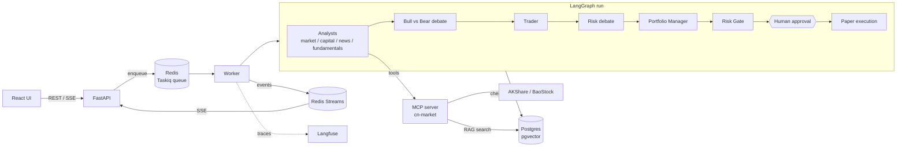
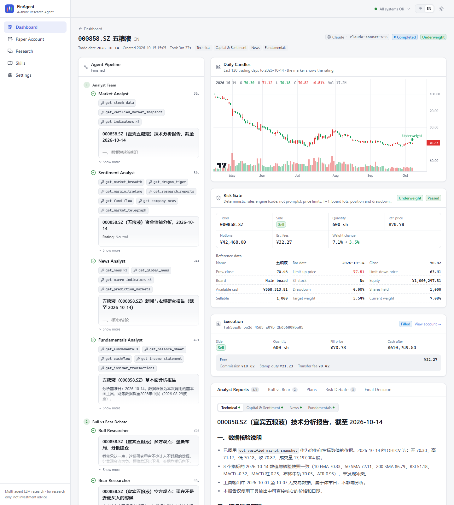
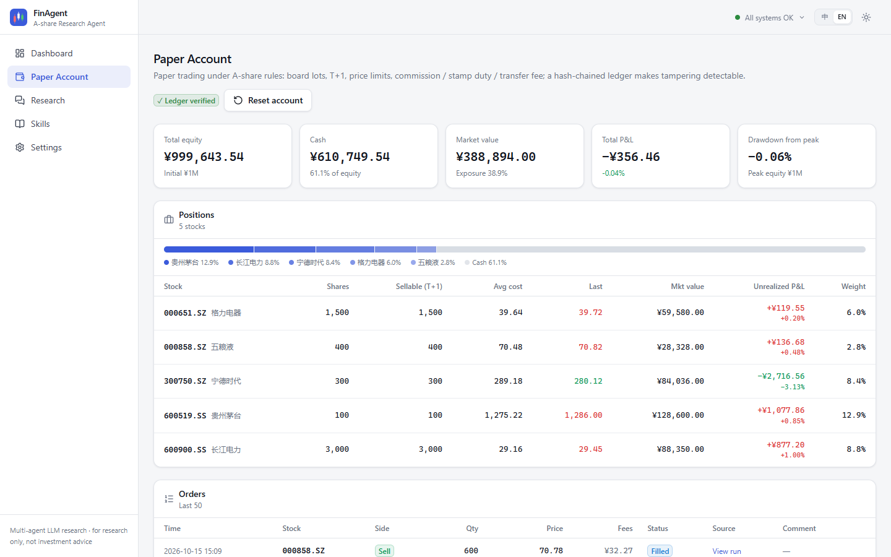
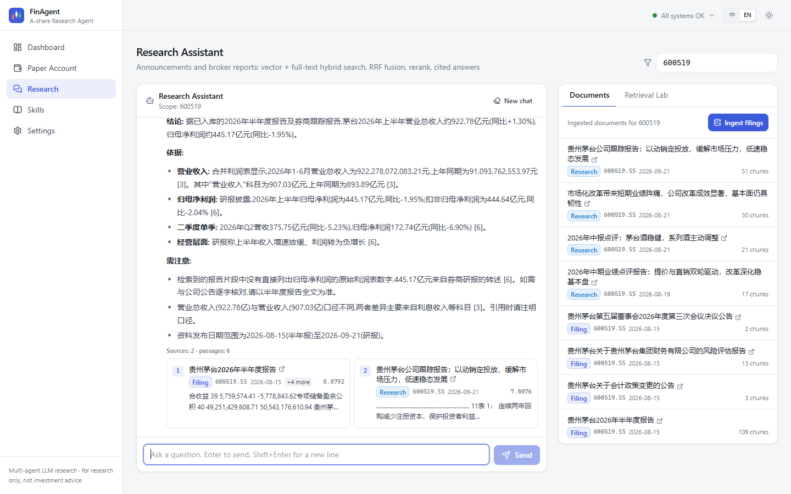
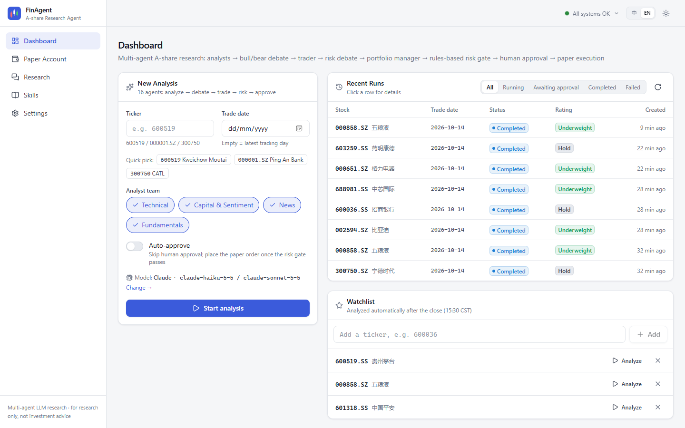
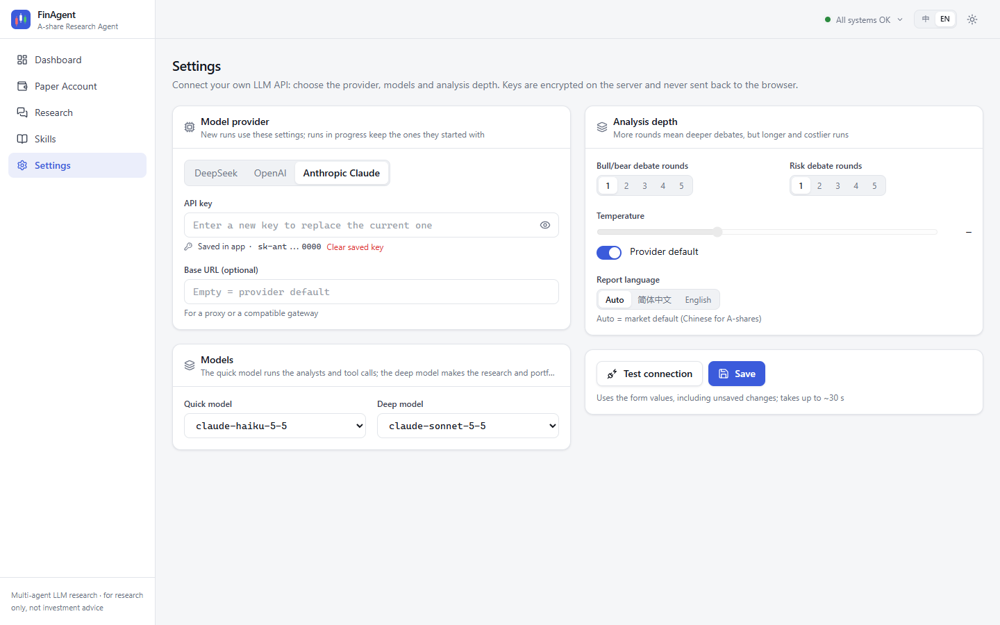
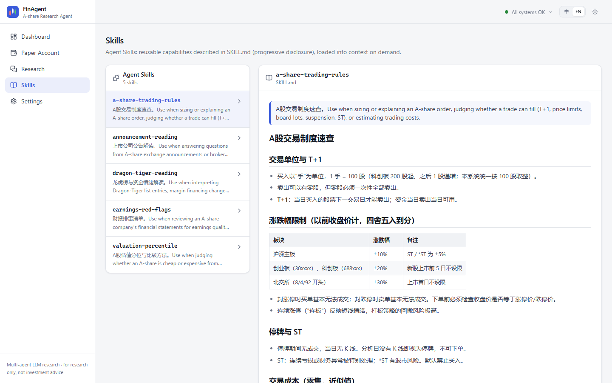

<div align="center">

<picture>
  <source media="(prefers-color-scheme: dark)" srcset="docs/assets/logo-dark.svg">
  
</picture>

<p><strong>A-share multi-agent research and paper-trading platform</strong></p>

<p>
  <a href="LICENSE"></a>
  
  
  
  
  
  
</p>

<p><strong>English</strong> | <a href="README.zh-CN.md">简体中文</a></p>

</div>

<p align="center">
  
</p>

## Overview

FinAgent turns the [TradingAgents](https://github.com/TauricResearch/TradingAgents) multi-agent framework into a full A-share research platform. Analyst agents study a stock in parallel, bull and bear researchers debate, a trader and a risk committee refine the plan, and a portfolio manager decides. From there, deterministic code takes over: a risk gate sizes and vets the order against A-share rules, a human approves or resizes it, and a paper ledger books the fill.

- **A-share data layer**: AKShare / BaoStock vendors with source fallback, point-in-time statements (by publication date), Dragon-Tiger list, margin balances and market breadth.
- **MCP server**: 14 market-data tools, research search and Agent Skills, usable from the agents or any MCP client.
- **Human in the loop**: LangGraph `interrupt` before every order; runs are checkpointed in Postgres and resume on any worker.
- **Rules in code**: lot size, T+1, price limits, ST, position and drawdown limits are enforced by the risk engine, not by prompts.
- **Research RAG**: announcements and broker reports with hybrid retrieval (pgvector + jieba full-text, RRF, cross-encoder rerank) and citations.
- **Bring your own model**: switch between DeepSeek, OpenAI and Claude in the UI, tune debate depth and sampling; keys are encrypted at rest.
- **Observability**: live SSE streaming of every agent, Langfuse tracing, LLM-as-judge evaluation and a retrieval benchmark.

## Architecture



| Layer | Stack |
| --- | --- |
| Agents | LangGraph 1.x (subgraphs, `interrupt`, Postgres checkpointer and store), TradingAgents, DeepSeek / OpenAI / Claude |
| Tools | MCP (FastMCP, streamable HTTP), `langchain-mcp-adapters` with point-in-time interceptors, Agent Skills (`SKILL.md`) |
| Retrieval | pgvector HNSW, Postgres full-text with jieba, RRF, fastembed (`bge-small-zh`, `bge-reranker-v2-m3`) |
| Backend | FastAPI, SSE over Redis Streams, Taskiq workers and cron, SQLAlchemy 2 async, Alembic |
| Frontend | React 19, TypeScript, Vite, Tailwind CSS 4, TanStack Query, lightweight-charts |
| Ops | Docker Compose, Kubernetes (Kustomize), Langfuse v4, GitHub Actions |

## Screenshots

| Live analysis | Paper portfolio |
| --- | --- |
|  |  |
| **Research assistant** | **Dashboard** |
|  |  |
| **Model settings** | **Agent Skills** |
|  |  |

## Quick start

Requirements: Docker, and an API key for DeepSeek, OpenAI or Anthropic.

```bash
git clone https://github.com/Erikdai/fin-agent.git && cd fin-agent
cp .env.example .env            # optional: set a key here, or later in the Settings page
docker compose up -d --build    # web UI on http://localhost:8080, API docs on http://localhost:8000/docs
```

Optional tracing: `docker compose --profile observability up -d` starts Langfuse on `http://localhost:3000`; set `LANGFUSE_PUBLIC_KEY`, `LANGFUSE_SECRET_KEY` and `LANGFUSE_HOST` in `.env`.

### Local development

```bash
docker compose up -d postgres redis
uv venv && uv pip install -e ".[platform-dev]"
alembic upgrade head

python -m finagent.mcp_server --transport streamable-http --port 8001
taskiq worker finagent.worker.broker:broker finagent.worker.tasks
uvicorn finagent.api.main:app --reload
cd frontend && npm install && npm run dev   # http://localhost:5173
```

### Use the MCP server from Claude Desktop or Cursor

```json
{ "mcpServers": { "cn-market": { "command": "python", "args": ["-m", "finagent.mcp_server"] } } }
```

### Tests and evaluation

```bash
pytest                                   # unit tests, offline
pytest -m integration tests/finagent     # needs Postgres and Redis
python -m finagent.evals judge --recent 5
python -m finagent.evals rag --dataset path/to/queries.jsonl
```

## Project structure

```
finagent/          platform: graph, risk, portfolio, rag, memory, mcp_server, api, worker, evals
tradingagents/     multi-agent core (upstream), plus A-share vendors in dataflows/vendors/cn
frontend/          React web UI
skills/            Agent Skills (SKILL.md playbooks)
deploy/            Dockerfile, Postgres init, Kubernetes manifests
tests/             unit and integration tests
```

## Disclaimer

FinAgent is a research project. It trades on a paper account only and nothing it produces is investment advice.

## Acknowledgements

Built on [TradingAgents](https://github.com/TauricResearch/TradingAgents) by Tauric Research (Apache-2.0).

## Author

Dai Cheng Xiao ([@Erikdai](https://github.com/Erikdai))

## License

[Apache License 2.0](LICENSE)
