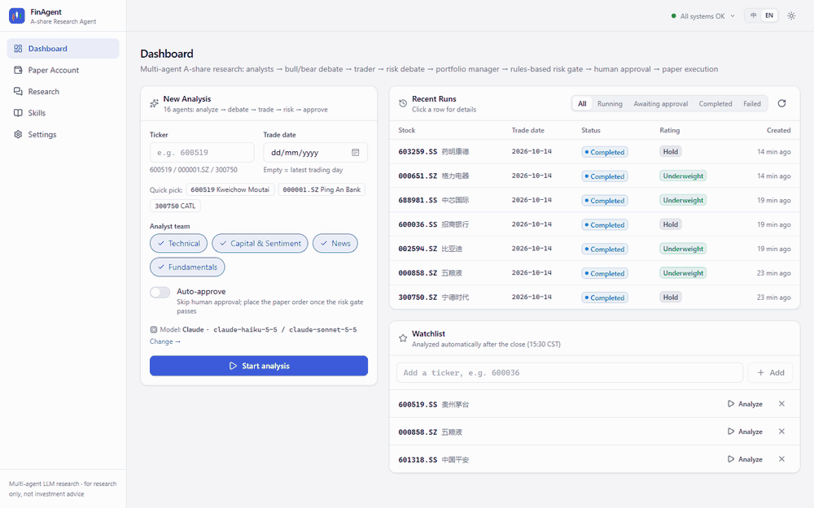
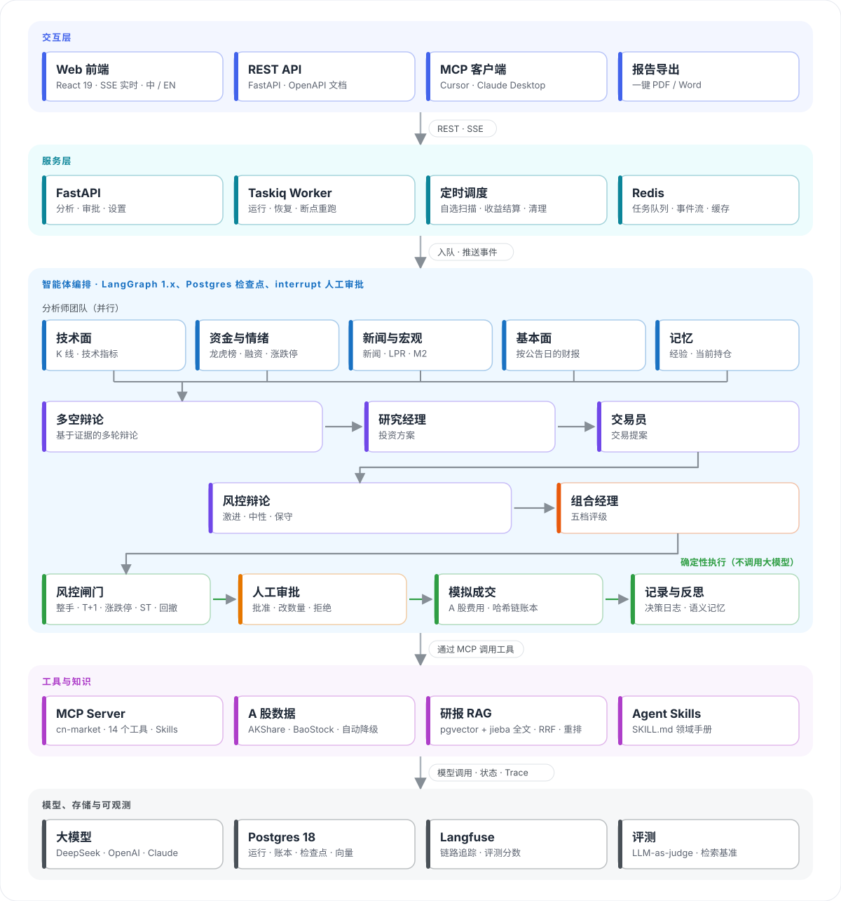
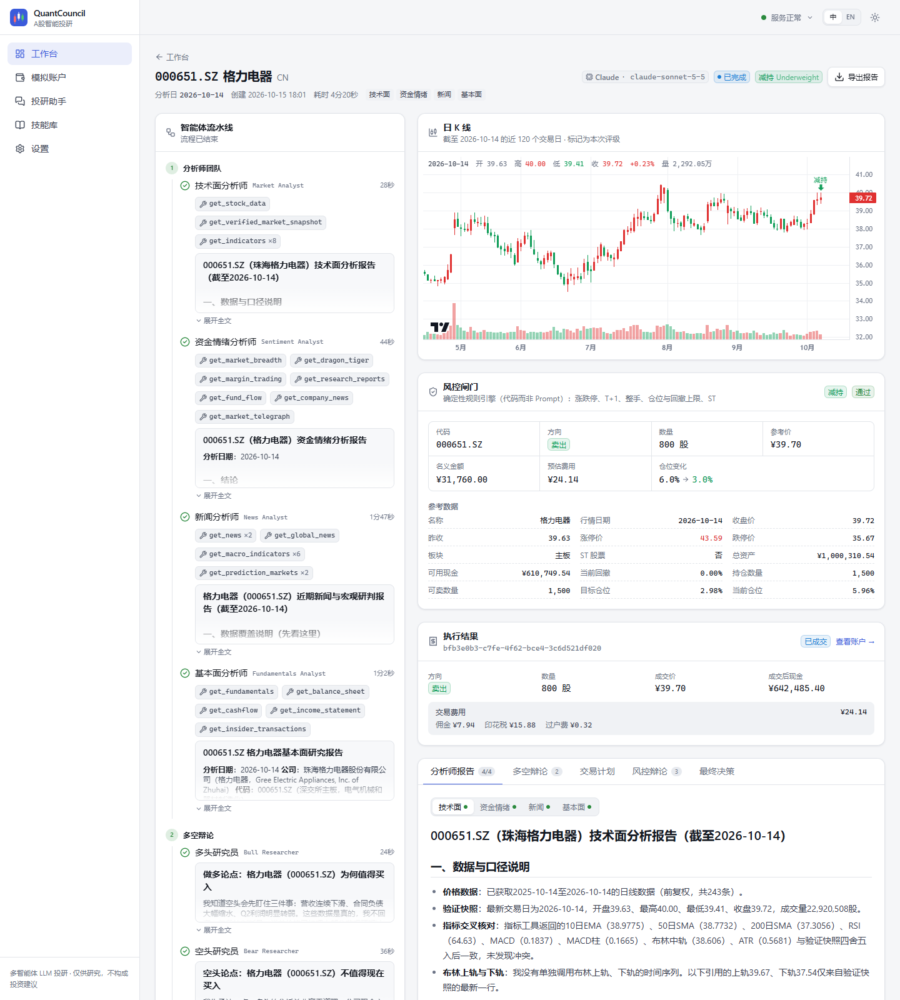
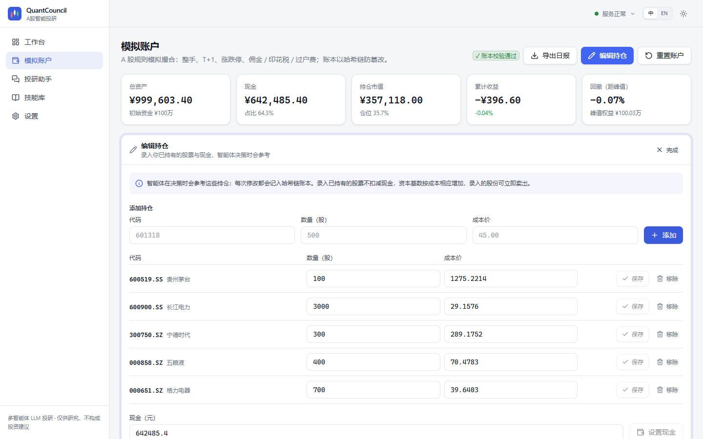
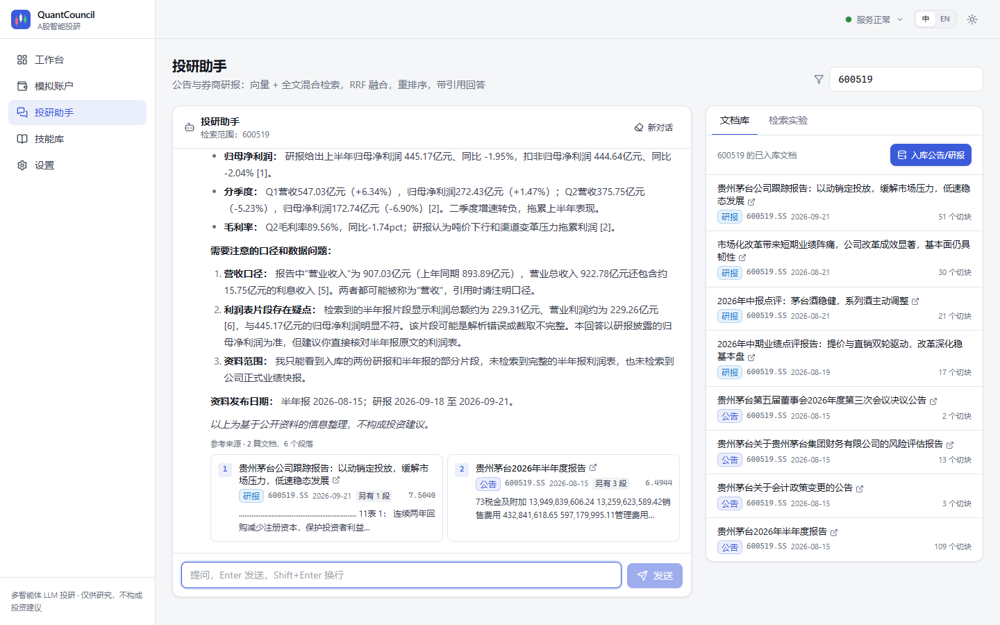
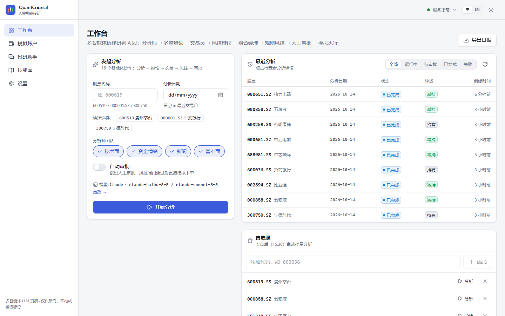
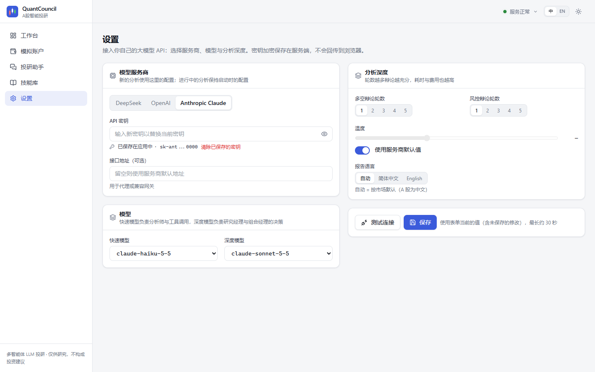
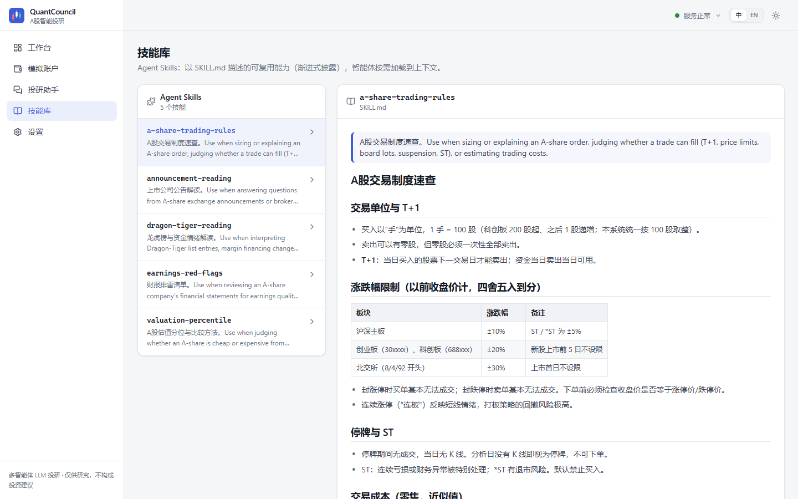

<div align="center">

<picture>
  <source media="(prefers-color-scheme: dark)" srcset="docs/assets/logo-dark.svg">
  
</picture>

<p><strong>QuantCouncil（量化投委会）：A 股多智能体投研与模拟交易平台</strong></p>

<p>
  <a href="LICENSE"></a>
  
  
  
  
  
  
</p>

<p><a href="README.md">English</a> | <strong>简体中文</strong></p>

</div>

<p align="center">
  
</p>

## 项目简介

QuantCouncil 基于 [TradingAgents](https://github.com/TauricResearch/TradingAgents) 多智能体框架，构建了一个完整的 A 股投研平台。分析师智能体并行研究个股，多空研究员辩论，交易员与风控委员会完善方案，组合经理给出决策。此后交给确定性代码：风控闸门按 A 股规则计算并校验订单，人工审批或修改数量，最后由模拟账本成交记账。

- **A 股数据层**：AKShare / BaoStock 多数据源自动降级，财报按公告日做时点过滤，支持龙虎榜、融资融券与涨跌停情绪。
- **MCP Server**：14 个行情与资金面工具、研报检索和 Agent Skills，智能体与任意 MCP 客户端均可调用。
- **人在回路**：每笔订单前使用 LangGraph `interrupt` 暂停审批；运行状态持久化在 Postgres，可在任意 worker 上恢复。
- **规则写在代码里**：整手、T+1、涨跌停、ST、仓位上限与回撤熔断由风控引擎强制执行，而不是靠提示词。
- **研报 RAG**：公告与券商研报混合检索（pgvector + jieba 全文检索，RRF 融合，交叉编码器重排），回答附引用。
- **按你的持仓决策**：录入自己的持仓与现金，智能体围绕持仓给出决策，风控闸门据此计算订单。
- **一键导出报告**：日报与单次分析的完整研报均可导出为 PDF 或 Word。
- **自带模型**：在界面中切换 DeepSeek、OpenAI、Claude，调整辩论轮数与采样参数，API Key 加密存储。
- **可观测与评测**：SSE 实时推送每个智能体的输出，Langfuse 链路追踪，LLM-as-judge 报告评分与检索基准测试。

## 系统架构

<p align="center">
  
</p>

| 层级 | 技术栈 |
| --- | --- |
| 智能体 | LangGraph 1.x（子图、`interrupt`、Postgres Checkpointer 与 Store）、TradingAgents、DeepSeek / OpenAI / Claude |
| 工具 | MCP（FastMCP，Streamable HTTP）、`langchain-mcp-adapters` 时点拦截器、Agent Skills（`SKILL.md`） |
| 检索 | pgvector HNSW、Postgres 全文检索 + jieba、RRF、fastembed（`bge-small-zh`、`bge-reranker-v2-m3`） |
| 后端 | FastAPI、基于 Redis Streams 的 SSE、Taskiq 任务与定时调度、SQLAlchemy 2 异步、Alembic |
| 前端 | React 19、TypeScript、Vite、Tailwind CSS 4、TanStack Query、lightweight-charts |
| 运维 | Docker Compose、Kubernetes（Kustomize）、Langfuse v4、GitHub Actions |

## 界面截图

| 实时分析 | 模拟账户 |
| --- | --- |
|  |  |
| **投研助手** | **工作台** |
|  |  |
| **模型设置** | **技能库** |
|  |  |

## 快速开始

环境要求：Docker，以及 DeepSeek、OpenAI 或 Anthropic 任一家的 API Key。

```bash
git clone https://github.com/Erikdai/quantcouncil.git && cd quantcouncil
cp .env.example .env            # 可在此填写 Key，也可稍后在设置页面填写
docker compose up -d --build    # 前端 http://localhost:8080，API 文档 http://localhost:8000/docs
```

可选链路追踪：`docker compose --profile observability up -d` 会在 `http://localhost:3000` 启动 Langfuse，并在 `.env` 中设置 `LANGFUSE_PUBLIC_KEY`、`LANGFUSE_SECRET_KEY`、`LANGFUSE_HOST`。

### 本地开发

```bash
docker compose up -d postgres redis
uv venv && uv pip install -e ".[platform-dev]"
alembic upgrade head

python -m quantcouncil.mcp_server --transport streamable-http --port 8001
taskiq worker quantcouncil.worker.broker:broker quantcouncil.worker.tasks
uvicorn quantcouncil.api.main:app --reload
cd frontend && npm install && npm run dev   # http://localhost:5173
```

### 在 Claude Desktop 或 Cursor 中使用 MCP Server

```json
{ "mcpServers": { "cn-market": { "command": "python", "args": ["-m", "quantcouncil.mcp_server"] } } }
```

### 测试与评测

```bash
pytest                                   # 单元测试，离线运行
pytest -m integration tests/quantcouncil     # 需要 Postgres 与 Redis
python -m quantcouncil.evals judge --recent 5
python -m quantcouncil.evals rag --dataset path/to/queries.jsonl
```

## 目录结构

```
quantcouncil/          平台层：graph、risk、portfolio、rag、memory、mcp_server、api、worker、evals
tradingagents/     多智能体核心（上游），A 股数据源位于 dataflows/vendors/cn
frontend/          React 前端
skills/            Agent Skills（SKILL.md 领域手册）
deploy/            Dockerfile、Postgres 初始化、Kubernetes 清单
tests/             单元测试与集成测试
```

## 免责声明

QuantCouncil 是研究项目，仅在模拟账户中交易，其输出不构成任何投资建议。

## 致谢

基于 Tauric Research 的 [TradingAgents](https://github.com/TauricResearch/TradingAgents)（Apache-2.0）构建。

## 作者

Dai Cheng Xiao（[@Erikdai](https://github.com/Erikdai)）

## 许可证

[Apache License 2.0](LICENSE)
